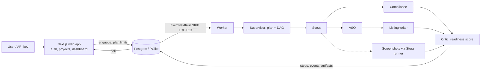

# Stora Launch Copilot: multi-agent SaaS built on Stora

Customers connect an app repo; a supervisor plans a run and a team of agents audits it for store launch.



| Component | Path | Role |
|---|---|---|
| Data layer | `packages/db` | Drizzle schema, migrations, repos, DB-backed queue, plan limits |
| Agents | `packages/agents` | Scout, Compliance, ASO, Listing, Screenshots, Critic + Supervisor |
| Runtime | `packages/runtime` | Worker loop, DB sink, config |
| Worker | `apps/worker` | Standalone worker process (production) |
| Web | `apps/web` | Auth, projects, runs, live view, billing stub, REST API |

| Plan | Runs/mo | Projects | Price (stub) |
|---|---|---|---|
| Free | 5 | 1 | $0 |
| Pro | 100 | 10 | $49 |
| Agency | 1000 | 100 | $199 |

## Run locally (zero setup)
```bash
pnpm install && pnpm build
cd apps/web && pnpm dev     # embedded PGlite + in-process worker; http://localhost:3000
```
Production: `docker compose -f docker-compose.launch.yml up --build` (see `.env.launch.example`; copy it to `.env`).

## REST API
`Authorization: Bearer <key>` (create under API keys): `GET /api/v1/projects`, `GET|POST /api/v1/runs` (`{projectId, goal}`), `GET /api/runs/:id`, `GET /api/artifacts/:id`.

## Honest limits
- Without `ANTHROPIC_API_KEY`/Google key, agents use heuristics; the LLM path is tested against mocks only.
- Screenshots need Stora's macOS runner; tested only against a fake runner API.
- Billing is a stub (plan switch, no payments). Dynamic compliance testing is disabled upstream (private `mobile-use` package).
- Stora's runner API has no per-tenant isolation; do not expose it to untrusted tenants.
